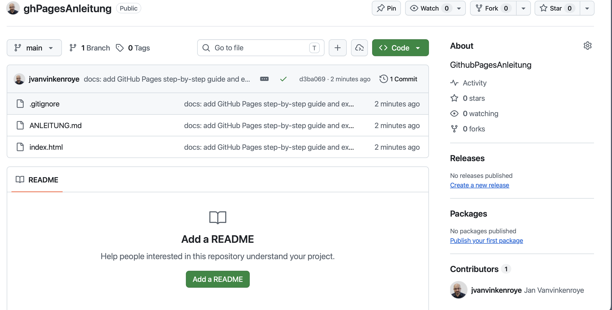
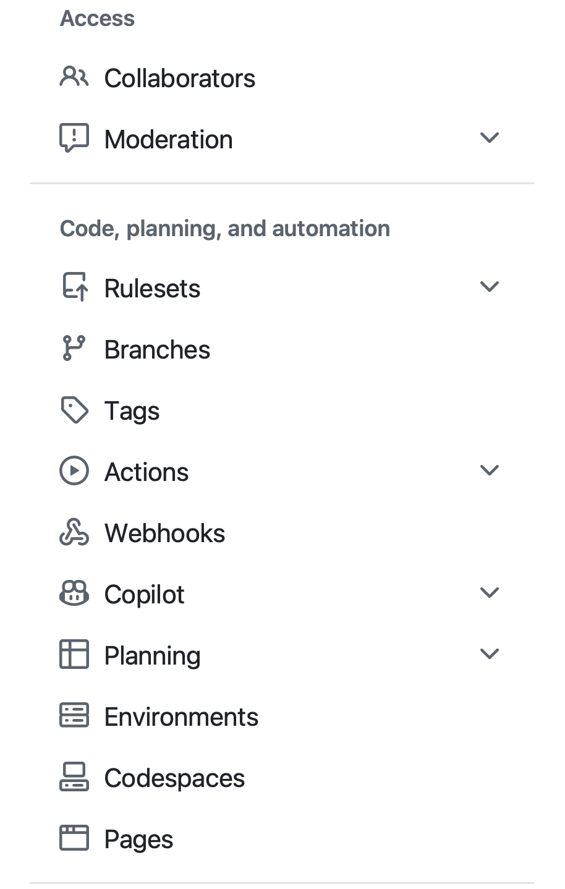
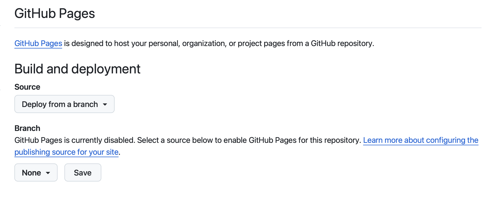
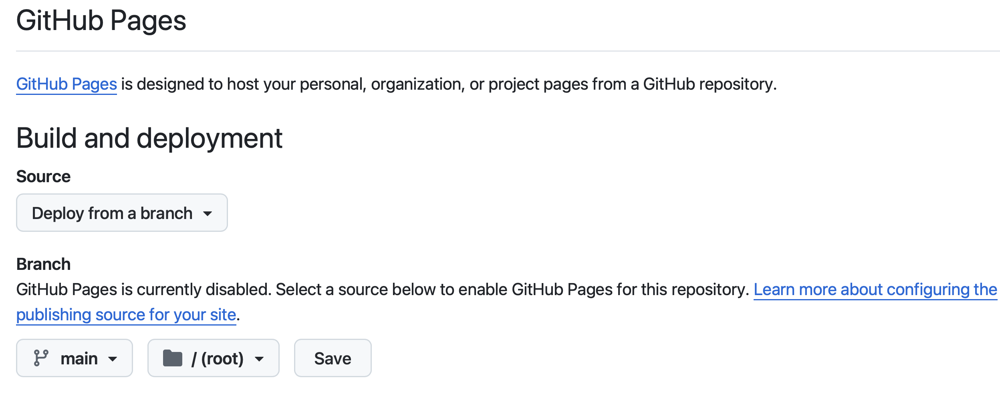
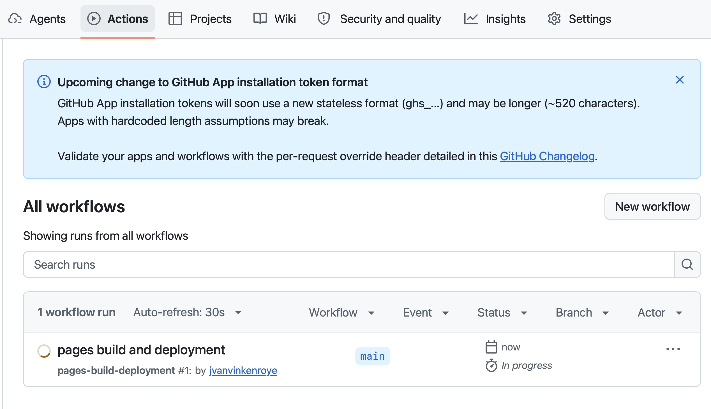

# Eine eigene Webseite mit GitHub Pages veröffentlichen

Schritt-für-Schritt-Anleitung: vom GitHub-Konto bis zur fertigen Webseite aus einer
einzigen `index.html`.

**Was du am Ende hast:** eine öffentlich erreichbare Webseite unter
`https://<dein-benutzername>.github.io/<repository-name>/`

**Was du brauchst:**

- eine E-Mail-Adresse, auf die du Zugriff hast
- eine fertige Datei `index.html` (Beispiel siehe Anhang)
- einen aktuellen Browser
- ein Smartphone mit Authenticator-App (für die Zwei-Faktor-Anmeldung, siehe Schritt 2)

**Zeitbedarf:** ca. 20–30 Minuten, davon einige Minuten Wartezeit.

---

## Teil 1: GitHub-Konto anlegen und anmelden

### Schritt 1: Registrieren

1. Öffne <https://github.com> und klicke oben rechts auf **Sign up**.
2. Gib ein:
   - **E-Mail-Adresse**
   - **Passwort**: mindestens 15 Zeichen *oder* mindestens 8 Zeichen mit
     mindestens einer Zahl und einem Kleinbuchstaben
   - **Username**: Achtung, der Benutzername wird Teil der Webadresse
     (`username.github.io`). Wähle etwas Seriöses, kurz, ohne Sonderzeichen.
     Erlaubt sind nur Buchstaben, Ziffern und einzelne Bindestriche.
   - **Land/Region**
3. Löse das Prüf-Rätsel (Captcha).
4. GitHub schickt dir einen **Bestätigungscode per E-Mail** (8-stellig). Gib ihn ein.

> **Wartezeit:** Die Mail kommt meist innerhalb von 1–2 Minuten.
> Kommt nichts: Spam-Ordner prüfen, dann **Resend the code** klicken.
> Uni- und Firmen-Mailserver filtern solche Mails manchmal zeitverzögert.

5. Fragen zur Person/Team kannst du überspringen. Wähle den **Free**-Plan.

### Schritt 2: Anmelden und Zwei-Faktor-Authentifizierung (2FA)

1. Melde dich unter <https://github.com/login> mit Benutzername (oder E-Mail) und
   Passwort an.
2. GitHub verlangt für Konten, die Inhalte hochladen, die **Zwei-Faktor-
   Authentifizierung**. Du wirst dazu aufgefordert (ggf. erst nach einigen Tagen).
   Einrichten unter: Profilbild oben rechts → **Settings** → **Password and
   authentication** → **Enable two-factor authentication**.
3. Scanne den QR-Code mit einer Authenticator-App (z. B. Microsoft Authenticator,
   Google Authenticator, 2FAS) und gib den 6-stelligen Code ein.
4. **Wiederherstellungscodes (Recovery Codes) herunterladen und sicher aufbewahren!**
   Wer Handy und Codes verliert, verliert den Zugang zum Konto.

---

## Teil 2: Repository anlegen und `index.html` hochladen

### Schritt 3: Neues Repository erstellen

1. Klicke oben rechts auf **+** → **New repository**.
2. Fülle aus:
   - **Repository name**: z. B. `meine-webseite`
     (keine Leerzeichen, keine Umlaute; Kleinschreibung empfohlen, weil der Name in
     der URL erscheint)
   - **Visibility**: **Public**
     Beim kostenlosen Plan funktioniert GitHub Pages **nur mit öffentlichen
     Repositories**.
   - Optional: Haken bei **Add a README file**
3. Klicke auf **Create repository**.

> **Tipp:** Nennst du das Repository exakt `<dein-benutzername>.github.io`, liegt
> die Seite direkt unter `https://<dein-benutzername>.github.io/` (ohne Unterpfad).
> Davon gibt es pro Konto genau eines.

### Schritt 4: `index.html` hochladen

1. Im neuen Repository: **Add file** → **Upload files**
   (bei einem leeren Repository: Link **uploading an existing file**).
2. Ziehe deine `index.html` (und ggf. Bilder, CSS-Dateien, Ordner) in das Fenster.
3. Unten bei **Commit changes** eine kurze Beschreibung eingeben, z. B.
   „Webseite hinzugefügt“, und **Commit changes** klicken.
4. Prüfe: Die Datei `index.html` muss jetzt **direkt auf der obersten Ebene**
   des Repositorys sichtbar sein, nicht in einem Unterordner.



*Neben dem Repository-Namen steht **Public**, `index.html` liegt auf der obersten
Ebene. Oben rechts in der Reiterleiste (hier nicht im Bild) findest du **Settings**.*

---

## Teil 3: GitHub Pages einschalten

### Schritt 5: Publishing Source konfigurieren

1. Im Repository oben auf **Settings** klicken (Zahnrad-Symbol; bei schmalem
   Fenster unter dem Drei-Punkte-Menü **…** versteckt).
2. In der linken Seitenleiste im Abschnitt **Code, planning, and automation**
   ganz unten auf **Pages**.

   

3. Unter **Build and deployment** → **Source**: **Deploy from a branch** wählen.
   Darunter steht zunächst „GitHub Pages is currently disabled“, der Branch steht
   auf **None**.

   

4. Unter **Branch**:
   - Im Dropdown **None** den Branch **main** auswählen
   - Im daneben erscheinenden Ordner-Dropdown **/ (root)** auswählen
5. **Save** klicken.

   

> Die Alternative **GitHub Actions** als Source ist nur nötig, wenn deine Seite
> vor dem Veröffentlichen gebaut werden muss (z. B. mit einem Static-Site-Generator).
> Für eine einfache `index.html` ist **Deploy from a branch** die richtige Wahl.

### Schritt 6: Warten, bis die Seite gebaut ist

Nach dem Speichern startet GitHub im Hintergrund einen Build.

- **Fortschritt sehen:** Im Repository auf den Reiter **Actions** klicken. Dort
  erscheint ein Lauf namens **pages build and deployment**.
  - gelber Kreis = läuft noch
  - grüner Haken = fertig
  - rotes X = Fehler (anklicken für Details)

  

  *Der Lauf ist noch „In progress“. Die Liste aktualisiert sich alle 30 Sekunden
  von selbst. Hinweisbanner wie hier oben können ignoriert werden.*
- **Typische Wartezeit:** 1–2 Minuten. GitHub gibt an, dass es **bis zu
  10 Minuten** dauern kann, bis Änderungen öffentlich sichtbar sind.
- Danach in **Settings → Pages** die Seite neu laden. Oben erscheint:
  **Your site is live at https://<benutzername>.github.io/<repository>/**
  mit einem Button **Visit site**.

### Schritt 7: Seite aufrufen und aktualisieren

1. Klicke auf **Visit site** oder öffne die URL direkt.
2. **Änderungen:** Datei im Repository bearbeiten (Stift-Symbol) oder neu hochladen
   und committen. Jeder Commit auf `main` löst automatisch einen neuen Build aus.
   Wieder 1–10 Minuten warten.
3. Siehst du trotzdem die alte Version: Browser-Cache umgehen mit
   **Strg+F5** (Windows/Linux) bzw. **Cmd+Shift+R** (macOS) oder ein privates
   Fenster öffnen.

---

## Teil 4: Häufige Fehler und Lösungen

| Problem | Ursache | Lösung |
|---|---|---|
| **404 – „There isn't a GitHub Pages site here“** | Build noch nicht fertig | Unter **Actions** warten, bis der grüne Haken erscheint; bis zu 10 Minuten |
| 404 trotz fertigem Build | Datei heißt nicht exakt `index.html` | Dateinamen prüfen: klein geschrieben, `.html` statt `.htm`, keine Endung `index.html.txt` (Windows blendet Endungen aus!) |
| 404 trotz fertigem Build | `index.html` liegt in einem Unterordner | Datei in die oberste Ebene verschieben oder in Settings → Pages den Ordner `/docs` wählen, falls sie dort liegt |
| Statt der Webseite wird die README angezeigt | `index.html` fehlt oder ist falsch benannt | GitHub nimmt `index.html`, `index.md` oder `README.md` als Startseite – in dieser Reihenfolge. Dateiname korrigieren |
| Menüpunkt **Pages** fehlt / Hinweis auf Upgrade | Repository ist **privat** (Free-Plan) | Settings → General → ganz unten **Danger Zone** → **Change visibility** → Public |
| Branch-Auswahl zeigt „None“ und nichts lässt sich wählen | Repository ist leer | Erst eine Datei hochladen (Schritt 4), dann Pages konfigurieren |
| Bilder oder CSS werden nicht geladen | Groß-/Kleinschreibung im Pfad stimmt nicht | GitHub Pages unterscheidet `Bild.JPG` und `bild.jpg`. Pfade in der HTML exakt wie die Dateinamen schreiben |
| Bilder oder CSS werden nicht geladen | Absolute Pfade wie `/style.css` oder `C:\Users\...` | **Relative** Pfade verwenden: `style.css`, `bilder/foto.jpg`. Ein führender `/` zeigt auf `benutzername.github.io/` statt auf das Repository |
| Ordner mit `_` am Anfang (z. B. `_assets`) fehlen | Jekyll ignoriert solche Ordner | Leere Datei namens `.nojekyll` auf oberster Ebene anlegen |
| Seite zeigt alten Stand | Browser-Cache oder Build läuft noch | Actions prüfen, dann Strg+F5 / Cmd+Shift+R |
| Build in **Actions** rot | z. B. fehlerhafte Datei, gelöschter `/docs`-Ordner | Lauf anklicken, Fehlermeldung lesen; nach Korrektur neu committen oder **Re-run jobs** |
| Seite wird nach Push nicht neu gebaut | Commit kam nicht von einem Konto mit verifizierter E-Mail | E-Mail-Adresse unter Settings → Emails bestätigen |
| Umlaute werden als `ä` o. Ä. angezeigt | Zeichenkodierung fehlt | In `<head>` die Zeile `<meta charset="utf-8">` einfügen und Datei als UTF-8 speichern |
| Bestätigungsmail kommt nicht an | Spamfilter | Spam-Ordner prüfen, Code neu anfordern, ggf. andere Mailadresse |

### Wichtig zum Datenschutz

Eine GitHub-Pages-Seite ist **für alle im Internet sichtbar**, ebenso das öffentliche
Repository mit allen Dateien und der kompletten Änderungshistorie.
**Keine Passwörter, privaten Adressen, Telefonnummern oder Fotos anderer Personen
hochladen.** Auch nachträglich gelöschte Dateien bleiben in der Historie abrufbar.

---

## Checkliste

- [ ] GitHub-Konto angelegt, E-Mail bestätigt
- [ ] 2FA eingerichtet, Recovery Codes gespeichert
- [ ] Repository angelegt, Sichtbarkeit **Public**
- [ ] `index.html` auf oberster Ebene hochgeladen (Name exakt, klein geschrieben)
- [ ] Settings → Pages → **Deploy from a branch** → `main` → `/ (root)` → **Save**
- [ ] Unter **Actions** grüner Haken bei „pages build and deployment“
- [ ] Seite unter `https://<benutzername>.github.io/<repository>/` erreichbar

---

## Anhang: Minimale Beispiel-`index.html`

```html
<!DOCTYPE html>
<html lang="de">
<head>
  <meta charset="utf-8">
  <meta name="viewport" content="width=device-width, initial-scale=1">
  <title>Meine erste Webseite</title>
</head>
<body>
  <h1>Hallo Welt!</h1>
  <p>Diese Seite wird mit GitHub Pages veröffentlicht.</p>
</body>
</html>
```

Mit einem Texteditor (nicht Word!) speichern, Dateiname exakt `index.html`,
Kodierung UTF-8.

---

**Quelle:** [GitHub Docs – Configuring a publishing source for your GitHub Pages
site](https://docs.github.com/en/pages/getting-started-with-github-pages/configuring-a-publishing-source-for-your-github-pages-site)
